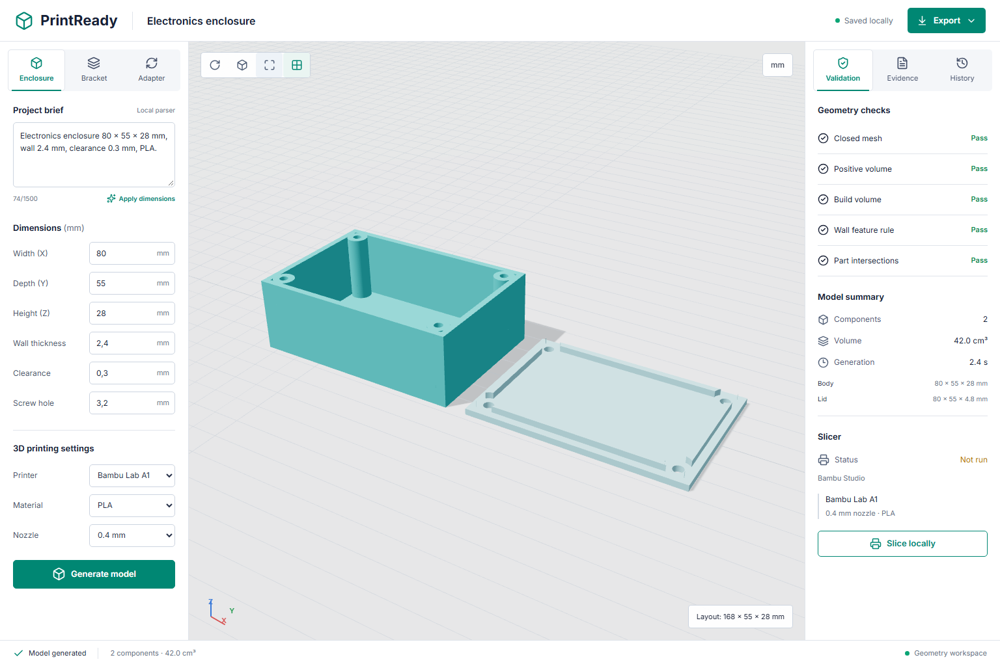
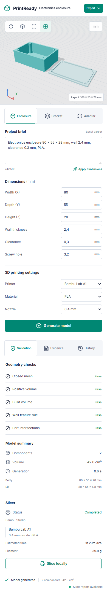

# PrintReady CAD Agent

[English / README principal](README.md) · Português (Brasil)

[](https://github.com/santosgus3dtech/print-ready-cad-agent/actions/workflows/ci.yml)

Um fluxo local e inspecionável que parte de um briefing de projeto com medidas, passa por CAD
paramétrico e verificações de geometria e chega à preparação para impressão. Codex, Claude e
outros clientes MCP podem recuperar evidências de projeto, gerar peças e inspecionar os arquivos
resultantes por meio de ferramentas tipadas.

A primeira versão oferece suporte a caixas para eletrônica, suportes em L e adaptadores com flange.
Ela usa sólidos reais de CadQuery/OpenCascade, validação real de malhas e um visualizador Three.js
da geometria exportada.



## O que funciona

- Três famílias de peças parametrizadas, com dimensões validadas e folga de encaixe explícita.
- Exportações STEP e STL para fabricação, 3MF somente de geometria e prévia GLB com unidades corretas em metros.
- Validade exata do CAD, malhas fechadas, volumes positivos, envelopes dos componentes e interseções de sólidos.
- Medições por componente, hashes SHA-256 dos artefatos e histórico local de geração em SQLite.
- Recuperação BM25 em notas de projeto versionadas, com identificadores de fonte inspecionáveis.
- Extração de dimensões em inglês/português, incluindo conversão de mm, cm e polegadas.
- Servidor MCP com ferramentas tipadas, recursos e um prompt de projeto.
- Fatiamento local com Bambu Studio, com resolução da herança de presets e arquivos incluídos.
  É necessária uma correspondência exata de presets; as falhas são registradas em vez de serem
  tratadas como fatiamentos bem-sucedidos.
- Bancada responsiva com órbita, zoom, aramado, grade, evidências e visualização de projetos salvos.

## Limites da IA e da validação

O cliente MCP fornece o raciocínio do modelo de linguagem. O controle de briefing no navegador
é um **analisador local de dimensões com limites definidos**, não um LLM nem um conversor
irrestrito de texto para CAD. A geração usa modelos confiáveis; o servidor não aceita nem executa
Python fornecido pelo usuário/modelo.

A recuperação atualmente consulta um pequeno conjunto ilustrativo de notas. Não é um banco
certificado de materiais nem um sistema de embeddings multimodais. A avaliação de recuperação
incluída mede apenas esse corpus.

A verificação de parede examina os parâmetros do modelo em relação ao bico selecionado, não cada
ponto de uma malha arbitrária. Aprovar as verificações de geometria não certifica resistência,
encaixe, sucesso no fatiador ou uma impressão física. Suportes, pontes, comportamento do material
e tolerâncias precisam de revisão no fatiador e na peça física.

Esta versão pública **não permite envio à impressora, aquecimento, movimento ou início de impressão**.

## Tecnologias

Python 3.11 · CadQuery/OpenCascade · trimesh · FastAPI · Pydantic · MCP Python SDK 2.x ·
rank-bm25 · SQLite · React · TypeScript · Three.js · Vite · pytest · Playwright · Ruff · GitHub Actions

## Executar

Requisitos: [uv](https://docs.astral.sh/uv/) e Node.js 24. Bambu Studio é opcional.

```powershell
uv sync --locked --python 3.11 --extra dev
npm --prefix frontend ci
npm --prefix frontend run build
uv run printready-api
```

Abra **http://127.0.0.1:8012** e gere um modelo. No Windows, `start.bat` realiza a configuração
e inicia a aplicação. Arquivos gerados, logs, perfis locais e o banco de histórico ficam em
`_data/`, ignorado pelo Git. As configurações opcionais estão documentadas em `.env.example`.

Para desenvolver o frontend, execute a API e `npm --prefix frontend run dev` em terminais separados.
O Vite serve http://127.0.0.1:5178 e encaminha as chamadas de API para a porta 8012.

## MCP

Inicie o servidor stdio:

```powershell
uv run printready-mcp
```

Configuração genérica de cliente (substitua o caminho pelo seu checkout):

```json
{
  "mcpServers": {
    "printready": {
      "command": "uv",
      "args": ["--directory", "/absolute/path/print-ready-cad-agent", "run", "printready-mcp"]
    }
  }
}
```

Ferramentas: `search_design_knowledge`, `plan_part`, `generate_part`, `inspect_job`, `list_design_jobs`,
`slice_design`. Recursos: `printready://profiles` e `printready://knowledge`.

Exemplo: peça ao seu cliente MCP para criar uma caixa de eletrônica de 80 x 55 x 28 mm, com parede
de 2.4 mm, folga da tampa de 0.3 mm por lado, parafusos de 3.2 mm e um perfil de fabricação A1/PLA.
Inspecione as notas citadas, o relatório de geometria e os artefatos exatos exportados antes de fatiar.

## Fatiamento

O primeiro adaptador de fatiador descobre o Bambu Studio local e resolve seus presets BBL incluídos,
incluindo configurações herdadas e arquivos G-code incluídos. Ele executa a CLI com seleção explícita
de máquina, processo, filamento e mesa. Um resultado bem-sucedido exige um 3MF fatiado com G-code embutido.

Os padrões da A1 usam exatamente os presets `Bambu Lab A1 0.4 nozzle`, `0.20mm Standard @BBL A1`
e `Generic PLA @BBL A1`. São configurações demonstrativas, não uma afirmação sobre o filamento
carregado pelo usuário. Revise-as antes do uso físico. A disponibilidade dos presets depende do
fatiador instalado.

O volume de construção da K1C é suportado para validação de geometria; um adaptador separado
de OrcaSlicer com correspondência exata de perfil é um marco posterior. Uma solicitação de K1C
nunca usa silenciosamente um perfil de fatiador da A1.

`model.3mf` contém geometria. Somente uma etapa de fatiamento bem-sucedida produz `sliced.3mf`
contendo G-code. O G-code gerado é mantido localmente para revisão e nunca é enviado à impressora.

## Verificações

```powershell
uv run ruff check .
uv run ruff format --check .
uv run pytest
uv run python -m printready.evaluate
npm --prefix frontend run format:check
npm --prefix frontend run build
npx --prefix frontend playwright install chromium
npm --prefix frontend run test:e2e
```

Os testes de geometria reimportam STEP, inspecionam STL e 3MF, verificam as unidades de GLB,
rejeitam parâmetros inválidos e exercitam falhas de volume de construção da impressora. Os testes
de API cobrem geração, downloads, verificações de origem e separação de perfis. Os testes MCP
verificam o contrato de ferramentas tipadas e uma sessão real de cliente stdio. O Playwright
exercita geração, evidências, histórico, downloads, entradas inválidas e ferramentas de visualização.
Verificações de pixels do canvas comprovam geometria visível, enquadramento e movimento em tamanhos
de desktop e celular. As capturas de teste normalmente vão para `_data/qa/`, ignorado pelo Git.
Defina `PRINTREADY_CAPTURE_PORTFOLIO=1` ao regenerar deliberadamente as capturas de portfólio versionadas.

O conjunto ilustrativo de recuperação com sete consultas atualmente alcança Recall@3 1.0 e
MRR@3 1.0; é uma avaliação básica, não evidência de generalização no mundo real. O fatiamento
local real para A1 também foi verificado com Bambu Studio; ele não faz parte da CI no Linux
e nenhuma impressão física foi validada.

<details>
<summary>Bancada no celular</summary>



</details>

## Próximos marcos

1. Completar casos reproduzíveis de fatiamento e calibração física para os modelos suportados.
2. Ampliar a recuperação com exemplos CAD licenciados e selecionados e resultados medidos de encaixe.
3. Adicionar adaptadores de inspeção do FreeCAD e de edição de malhas do Blender.
4. Adicionar um adaptador OrcaSlicer específico para K1C.
5. Construir uma integração privada separada, `print-ready-cad-agent-live`, para modelos pessoais,
   telemetria PiSentinel e impressão física explicitamente aprovada.

Consulte [arquitetura](docs/ARCHITECTURE.md), [referências](docs/REFERENCES.md) e
[segurança](SECURITY.md). Os repositórios público e privado futuro compartilham um núcleo CAD
reutilizável; credenciais operacionais e recursos pessoais não pertencem ao repositório público.

## Licença

MIT. As licenças de dependências e referências externas continuam pertencendo a seus respectivos titulares.
